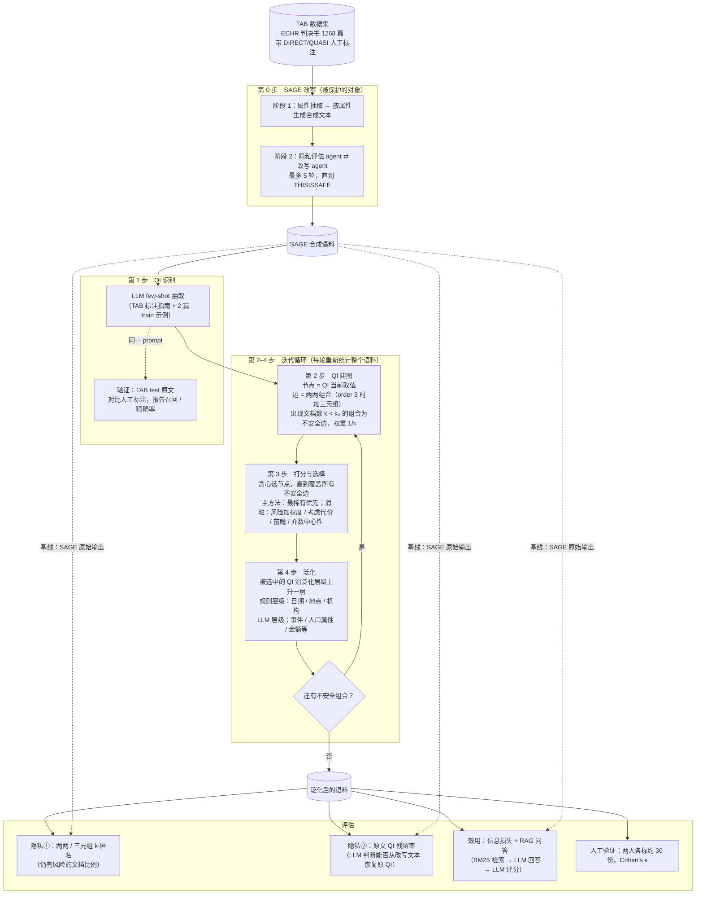

# 项目框架与进度

> ICDF2C 2027 论文：在 SAGE 改写后的合成 RAG 数据中发现并泛化**隐藏准标识符（hidden QI）**。
> 截稿 2026-12-15。本文档描述整体框架、每一步的输入输出和对应代码，以及当前进度。

## 1. 问题

SAGE（Zeng et al., EMNLP 2025）用 LLM 把 RAG 检索库改写成合成数据来保护隐私，但只评估了逐字抽取。
改写后的文本里仍有准标识符（QI）：单个 QI 看起来无害，组合起来却能在语料中唯一定位一篇文档。
本文在 SAGE 之后加一个后处理：找出 QI，按组合风险打分，迭代泛化，直到语料中不再有低于 k₀ 的 QI 组合。

**威胁模型**：攻击者拿到整个合成语料，只在语料内部组合显式 QI。不做链接回 HUDOC 的攻击，也不做黑盒查询攻击，这两类留给 EMNLP 2027 的工作。

## 2. 流程图

**对比方法**（都基于同一份 SAGE 输出和同一份 QI 抽取结果）：

| 方法 | 作用 |
|---|---|
| SAGE 原始输出 | 主基线 |
| SAGE + 抹掉全部 QUASI | 隐私上界 / 效用下界 |
| SAGE + 只按单值稀有度泛化 | 证明"只看单个 QI 不够" |
| SAGE + 同样泛化次数、随机分配 | 证明"选哪些 QI 比泛化多少更关键" |
| 风险图 + 随机节点 / 加权度 / 考虑代价 / 前瞻 / 介数中心性 | 消融：节点选择规则 |
| **ours（风险图 + 迭代覆盖 + 最稀有优先，order 2 / order 3）** | 本文方法 |

每种方法都扫 k₀ = 2、5、10，画隐私-效用曲线。

## 3. 每一步的输入、输出和代码

| 步骤 | 输入 | 输出 | 代码 |
|---|---|---|---|
| 0 SAGE 改写 | TAB 原文 | `data/sage/sage_echr.jsonl.gz`（最终文本、属性、每轮反馈、safe 标记） | `pipeline/sage.py` |
| 1 QI 识别 | SAGE 文本 | `data/qi/sage_qi.jsonl.gz`（实体、类型、DIRECT/QUASI、字符偏移） | `pipeline/qi_extract.py` |
| 1′ QI 识别验证 | TAB test 原文 + 人工标注 | `data/qi/validation/summary.json` | `pipeline/qi_extract.py validate` |
| 4′ 泛化层级 | 规则覆盖不了的 QI 取值 | `data/generalisation/llm_ladders.json` | `pipeline/ladders.py`，规则部分见 `qi_gen/core.py` 的 `ladder()` |
| 2–4 迭代循环 | QI 标注 + 泛化层级 | `results/sage/results.csv`、`data/corpora/`、`data/graphs/` | `pipeline/run_main.py`，核心算法见 `qi_gen/core.py` 的 `run_riskgraph()` |
| 评估 | 各版本语料 | `results/sage/residual.csv`、`results/sage/utility.csv` | `pipeline/evaluate.py` |
| 图表 | 上述结果 | `results/sage/figures/` | `pipeline/figures.py` |
| 全部 prompt | — | `prompts/*.txt` | `pipeline/prompts.py` |

一键运行：`run_all.sh`。所有 LLM 调用都缓存在 `data/llm_cache/`，重跑可以零成本得到相同结果。

## 4. 和最初设计相比的改动

| 原设计（CLAUDE.md） | 现在的做法 | 原因 |
|---|---|---|
| 第 1 步：在 TAB train 上微调模型识别 QI | LLM few-shot 抽取，在 TAB test 上验证 | 没有 GPU，时间紧；LLM 方案在 test 上 QUASI 实体召回 87.8% |
| 第 2 步：受 DrBC 启发，用 GNN 识别高介数节点 | 不训练 GNN；直接算风险图上的介数中心性，作为消融 | 精确计算在这个规模下足够快；实验中介数中心性不如风险加权度 |
| 第 4 步：agent 每轮泛化文本 | LLM 为每个取值**离线**生成一次泛化层级，循环中按层级确定性上升 | 可复现、成本低；循环决定"泛化谁"，层级决定"泛化成什么" |
| SAGE 结果由学弟提供 | 按官方代码重新实现 ECHR 版，LLM 用 DeepSeek | 保证整条流程统一 |
| 第 3 步打分 = 风险加权度 | 主方法用"风险图 + 迭代覆盖 + 最稀有优先"；加权度、考虑代价、前瞻、介数中心性作为消融 | 254 篇上最稀有优先信息损失最低；在 1268 篇的 TAB 上加权度更好。各规则差距 ≤ 4 个百分点，关键在框架本身 |
| 值只做大小写、标点归一 | 增加国家别名、时期写法、介词的统一；占位符不计入组合 | 减少 SAGE 多样写法造成的假"稀有值"，信息损失下降 5–10 个百分点 |

## 5. 当前进度（2026-11-25，可行性验证已完成）

| 步骤 | 状态 | 说明 |
|---|---|---|
| 数据 | ✅ | TAB 1268 篇。目前只用了 dev + test（254 篇），**待定：是否扩大到 1266 篇**（排除 2 篇 few-shot 示例） |
| 0 SAGE 改写 | ✅（254 篇） | 222 篇判为 safe，平均 3.26 轮，平均长度 5182 → 3467 字符，费用约 2.3 美元 |
| 1 QI 识别 | ✅ | test 验证：DIRECT 实体召回 97.8%，QUASI 87.8%（MISC 22%、DEM 43% 较弱）；SAGE 文本上抽出 3564 个 QUASI、123 个 DIRECT 实体 |
| 4′ 泛化层级 | ✅ | 规范化之后，1066 个取值由 LLM 生成层级，其余用规则层级 |
| 2–4 迭代循环 | ✅ | SAGE 输出上 k₀=2/5/10、全部基线和消融已跑完；TAB 原标注上的 pilot 也用最终代码重跑（`results/tab_gold/`） |
| 评估：k-匿名 | ✅ | ours 两两风险 0%，order 3 三元组风险也是 0%；SAGE 为 97.2% |
| 评估：原文 QI 残留率 | ✅ | SAGE 4.29% → ours 0.73%（下限 0.66% 来自 QI 抽取的漏标） |
| 评估：RAG 效用 | ✅ | ours 相对 SAGE −0.2 到 −1.2 分，95% 置信区间都包含 0 |
| 人工验证 κ | ⏳ 材料已准备好（`data/human_eval/`） | 需要你和学弟标注 |
| 论文写作 | ❌ 未开始 | LNICST 模板 |

**完整结果与分析见 [`results_analysis.md`](results_analysis.md)。**

### 已观察到、需要在论文中讨论的现象
- 用 DeepSeek 跑的 SAGE 改写得很彻底，试跑中**原文 QI 几乎没有字面残留**。但 SAGE 自己写出的 QI 组合（如 "late 1990s" + "early 1950s" + "a prison in Turkey"）在语料内部仍然唯一。所以本文的主要证据应该来自**语料内部的组合风险**，而不是原文 QI 残留率。
- 已泛化到顶层占位符（如 `[DATETIME]`）的值只透露"这里有一个日期"，不再计入 QI 组合统计。
